<h1 align="center">TaskBar Plus</h1>

<p align="center">
  可插拔的 Windows 任务栏插件工具 —— 在任务栏上挂一条可定制的 Dock，按需安装插件，即点即用。
</p>

<p align="center">
  
  
  
  
</p>

<p align="center">
  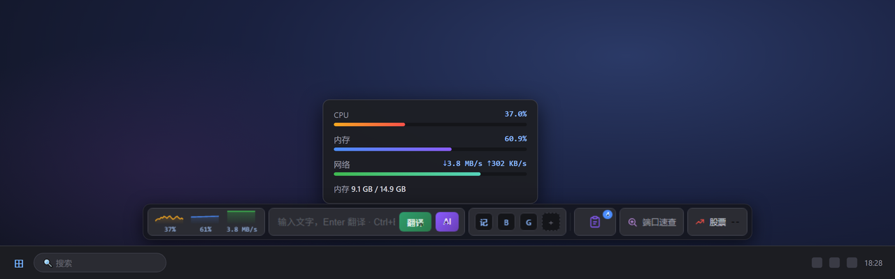
  <br>
  <sub>Dock 条效果示意：插件条贴任务栏悬浮，点击弹出面板（截图为示例数据渲染）。</sub>
</p>

## 特性

- **可插拔插件系统** —— 插件 = `plugin.json` + `index.html` 单文件，宿主以 iframe 加载、`window.tbp` 桥通信；市场在线安装 / 更新 / 一键卸载，装插件不需要重新编译主程序
- **权限网关** —— 每个插件声明所需权限（network / shell / fs / clipboard / hosts / net / docker / git / proxy …），每次调用逐条校验
- **可定制外观** —— 背景颜色 / 背景图片 / 不透明度、dock 最大长度与拖拽、全局与单插件自定义 CSS 注入、多套预设皮肤一键切换
- **按需采样** —— 禁用插件立即退订后台任务（如系统监控停止采样），不占资源

## 内置插件

<table>
  <tr>
    <td width="33%" align="center"><b>系统监控</b><br>CPU / 内存 / 网络迷你曲线，一键清理内存<br>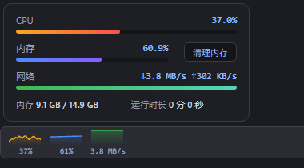</td>
    <td width="33%" align="center"><b>快捷输入</b><br>回车翻译，Ctrl+回车问 AI<br>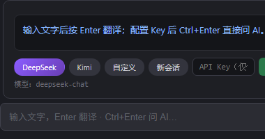</td>
    <td width="33%" align="center"><b>剪贴板历史</b><br>记录文本复制历史，点击重贴<br>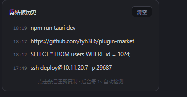</td>
  </tr>
  <tr>
    <td width="33%" align="center"><b>端口速查</b><br>输入端口看谁占用，一键结束进程<br>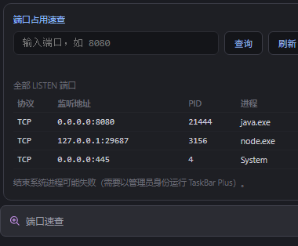</td>
    <td width="33%" align="center"><b>抓包代理</b><br>类 Fiddler 系统代理抓包，HTTPS 解密<br>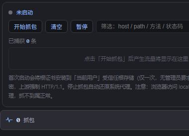</td>
    <td width="33%" align="center"><b>Hosts 切换</b><br>多套 hosts 方案保存即应用<br>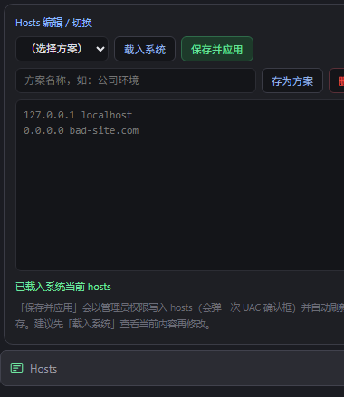</td>
  </tr>
  <tr>
    <td width="33%" align="center"><b>Git 助手</b><br>看分支，一键 Pull / Push / 切分支<br>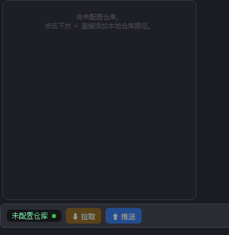</td>
    <td width="33%" align="center"><b>Docker 面板</b><br>容器状态灯，一键重启 / 看日志<br>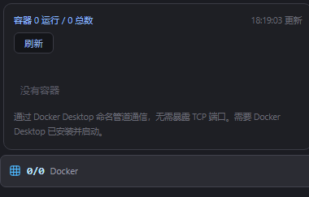</td>
    <td width="33%" align="center"><b>HTTP 请求</b><br>轻量 Postman：方法 / 头 / 体 / 响应<br>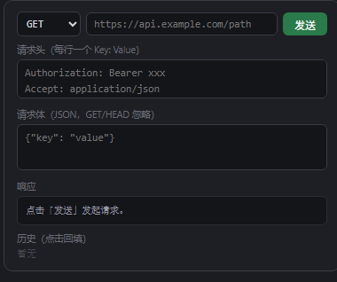</td>
  </tr>
  <tr>
    <td width="33%" align="center"><b>保活请求</b><br>定时 HTTP 请求，保活 VPN 防断连<br>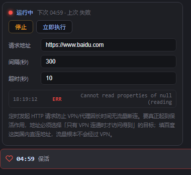</td>
    <td width="33%" align="center"><b>快捷启动</b><br>应用 / 网站 / 文件夹图标即点即开<br>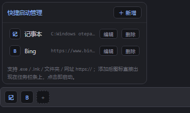</td>
    <td width="33%" align="center"><b>邮件提醒</b><br>IMAP 未读轮询（QQ / 163 / Gmail）<br>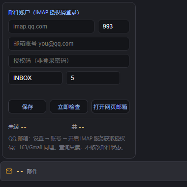</td>
  </tr>
  <tr>
    <td width="33%" align="center"><b>文件搜索</b><br>基于 Everything 的本地秒搜<br>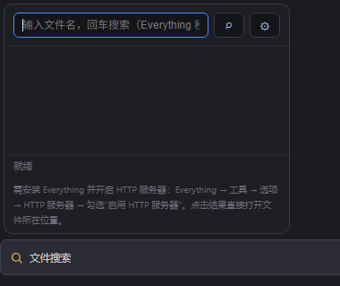</td>
    <td width="33%" align="center"><b>RSS 订阅</b><br>订阅聚合，条上滚动头条<br>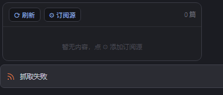</td>
    <td width="33%" align="center"><b>股票盯盘</b><br>自选股实时行情，涨红跌绿<br>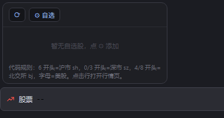</td>
  </tr>
  <tr>
    <td width="33%" align="center"><b>天气</b><br>当前城市天气（wttr.in）<br></td>
    <td width="33%" align="center"><b>网盘 WebDAV</b><br>浏览目录、拖拽上传 / 下载<br>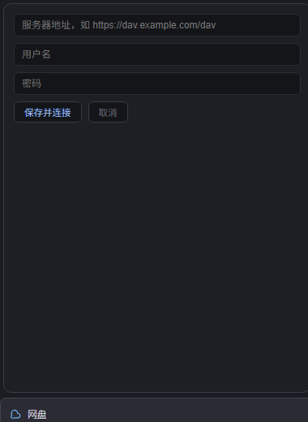</td>
    <td width="33%" align="center"><b>webtool 工具箱</b><br>JSON / Base64 / 时间戳 / 哈希等<br>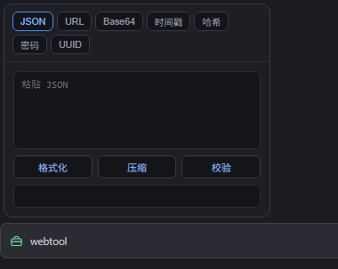</td>
  </tr>
</table>

## 构建与运行

```bash
npm install
npm run dev     # cargo tauri dev
npm run build   # cargo tauri build → src-tauri/target/release/taskbar-plus.exe
npm test        # cargo test + tests/contract.test.js + tests/smoke.ps1
```

## 插件开发

一个插件就是一个目录：`plugin.json`（清单）+ `index.html`（单文件，内联 CSS/JS），可选 `config` 字段声明可配置项。

```json
{
  "id": "my-plugin",
  "name": "我的插件",
  "version": "1.0.0",
  "description": "一句话说明",
  "width": { "min": 40, "max": 400, "default": 120 },
  "permissions": ["network"],
  "config": { "endpoint": "" }
}
```

插件通过 `window.tbp` 桥与宿主交互：

| API | 说明 |
| --- | --- |
| `tbp.ready()` | 渲染完成后必须调用，宿主据此测量真实宽度 |
| `tbp.call(api, args)` | 调用宿主能力，如 `clipboard.history`、`net.ports`、`stats.subscribe`、`dock.expand` 等 |
| `tbp.on(event, cb)` | 订阅宿主事件（如 `stats`、`dock.collapsed`），iframe 内注册 + 父窗口路由两段式 |
| `tbp.config()` / `tbp.saveConfig()` | 读写插件配置 |

插件协议约束（`tbp.on()` 两段式注册、必须调用 `tbp.ready()`、UTF-8 严格解码等）由 `tests/contract.test.js` 统一校验。

## 插件市场

主程序内置插件市场，从 GitHub 仓库加载 `market.json` 自动发现插件，支持搜索、在线安装、更新与一键卸载。市场仓库示例见 [fyh386/plugin-market](https://github.com/fyh386/plugin-market)。

## 目录结构

```
ui/                 前端（dock.js / settings.js，原生 JS，无打包）
plugins/<name>/     内置插件（plugin.json + index.html，编译期 include_dir! 嵌入）
src-tauri/src/      Rust 后端：main.rs / stats.rs / git.rs / plugins.rs / config.rs / anchor.rs
tests/              协议契约测试、冒烟脚本、截图流水线
release/            预编译 exe
```

## 下载

预编译可执行文件见 [`release/taskbar-plus.exe`](release/taskbar-plus.exe)。
